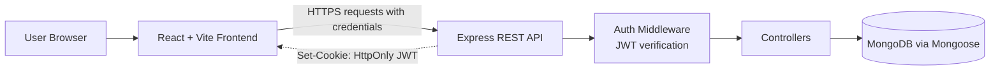

<div align="center">

# TaskFlow

### Student Productivity Manager

Plan smarter, prioritize clearly, and stay focused: one dashboard for every academic and personal task.


<!-- Add a live demo badge only after deployment, e.g.:
[](<YOUR_FRONTEND_URL>) -->

</div>

---

## Table of Contents

- [About the Project](#about-the-project)
- [Key Features](#key-features)
- [Technology Stack](#technology-stack)
- [Application Architecture](#application-architecture)
- [Screenshots](#screenshots)
- [Project Structure](#project-structure)
- [Prerequisites](#prerequisites)
- [Installation and Local Setup](#installation-and-local-setup)
- [Environment Variables](#environment-variables)
- [API Overview](#api-overview)
- [Authentication and Security](#authentication-and-security)
- [Deployment Guide](#deployment-guide)
- [Troubleshooting](#troubleshooting)
- [Future Enhancements](#future-enhancements)
- [Contributing](#contributing)
- [License](#license)
- [Author](#author)

---

## About the Project

TaskFlow is a full-stack web application that helps students organize their academic and personal tasks in one place. It combines a React single-page frontend with an Express REST API and a MongoDB database, so every user's tasks persist securely across sessions and devices.

### Problem Statement

Students juggle assignments, exams, projects, club commitments, and personal responsibilities, often across scattered notes, chat messages, and calendars. Without a clear system, deadlines get missed and it becomes hard to decide what to work on next.

### Objectives

- Give students a single, centralized place to capture and manage tasks.
- Make it easy to see what matters most through prioritization.
- Provide progress visibility through a productivity dashboard and statistics.
- Support focused work with planner recommendations and focus sessions.

### Benefits for Students

- Less time spent deciding what to do next.
- A clear view of completed versus pending work.
- Personal accounts with protected data, accessible from any browser.

---

## Key Features

| Feature | Description |
| --- | --- |
| Registration and login | Create an account and sign in with email-based credentials. |
| Authentication and protected routes | Authenticated sessions using JWT stored in HttpOnly cookies; private pages require sign-in. |
| Task management | Create, edit, complete, and delete tasks. |
| Search and filtering | Find tasks quickly and narrow the list by status or other attributes. |
| Task prioritization | Tasks are ranked so the most important work is visible first. |
| Productivity dashboard | Statistics and analytics summarizing task activity and progress. |
| Planner recommendations | Suggestions on what to work on next. |
| Focus sessions | Timed sessions to support concentrated work. |
| Responsive interface | Layout designed to work across desktop and mobile screen sizes. |

> **Note:** Review this table against the current state of the codebase before publishing, and remove or relabel any feature that is not fully implemented (for example, mark a feature "backend only" if its UI is not finished).

---

## Technology Stack

| Category | Technologies |
| --- | --- |
| Frontend | React, Vite, Tailwind CSS |
| Backend | Node.js, Express.js |
| Database | MongoDB, Mongoose |
| Authentication | JSON Web Tokens (JWT), HttpOnly cookies |
| Tools | Git, GitHub, VS Code |
| Deployment | Vercel (frontend), Render (backend), MongoDB Atlas (database) |

---

## Application Architecture



### Data Flow

1. The user interacts with the React frontend in the browser.
2. The frontend sends requests to the Express REST API, including credentials so the browser attaches the authentication cookie.
3. On login or registration, the server issues a JWT and sets it in an HttpOnly cookie. Frontend JavaScript cannot read this cookie.
4. For protected routes, authentication middleware verifies the JWT before the request reaches the controller.
5. Controllers read from and write to MongoDB through Mongoose models, and return JSON responses to the frontend.
6. The frontend updates the interface (task lists, dashboard statistics, planner suggestions) from those responses.

---

## Screenshots

Screenshots will be added to `docs/screenshots/`. Until the images exist, the links below will not render.

<!-- Replace each placeholder once the screenshot file has been added to the repository. -->

| Login | Dashboard |
| --- | --- |
|  |  |

| Tasks | Analytics |
| --- | --- |
|  |  |

---

## Project Structure

A representative layout. Adjust it to match your actual repository before publishing.

```text
taskflow/
├── docs/
│   └── screenshots/          # login.png, dashboard.png, tasks.png, analytics.png
├── public/
├── src/                      # React frontend
│   ├── components/           # Reusable UI components
│   ├── pages/                # Login, Register, Dashboard, etc.
│   ├── context/              # Authentication context
│   ├── hooks/                # Custom hooks (e.g., task management)
│   ├── services/             # API client layer
│   ├── App.jsx
│   └── main.jsx
├── server/                   # Express backend
│   ├── controllers/
│   ├── middleware/
│   ├── models/               # Mongoose schemas
│   ├── routes/
│   ├── .env.example
│   ├── app.js
│   ├── server.js
│   └── package.json
├── .env.example              # Frontend environment template
├── .gitignore
├── index.html
├── package.json
├── vite.config.js
└── README.md
```

---

## Prerequisites

| Tool | Notes |
| --- | --- |
| [Node.js](https://nodejs.org/) | Use a current LTS release. |
| npm | Installed with Node.js. |
| [Git](https://git-scm.com/) | For cloning the repository. |
| MongoDB | Either a local MongoDB installation or a free [MongoDB Atlas](https://www.mongodb.com/atlas) account. |

Verify your installation:

```bash
node --version
npm --version
git --version
```

---

## Installation and Local Setup

The frontend and backend run as separate processes. Use two terminals.

### 1. Clone the repository

```bash
git clone <YOUR_GITHUB_REPOSITORY_URL>
cd <YOUR_PROJECT_DIRECTORY>
```

### 2. Install dependencies

```bash
# Frontend (project root)
npm install

# Backend
cd server
npm install
```

### 3. Configure environment variables

Create the environment files from the templates described in [Environment Variables](#environment-variables).

Windows PowerShell:

```powershell
Copy-Item .env.example .env
Copy-Item server\.env.example server\.env
```

macOS / Linux:

```bash
cp .env.example .env
cp server/.env.example server/.env
```

Then edit both `.env` files and replace every placeholder value.

### 4. Start the backend (Terminal 1)

```bash
cd server
npm run dev
```

### 5. Start the frontend (Terminal 2)

From the project root:

```bash
npm run dev
```

### 6. Open the application

Vite prints the local URL in the terminal, typically `http://localhost:5173`. If that port is occupied, Vite automatically uses the next free port (for example `5174`). Always use the URL shown in the terminal, and make sure `CLIENT_ORIGIN` on the backend matches it.

> Script names above follow the expected setup flow. Confirm them against the `scripts` section of your `package.json` files.

---

## Environment Variables

Never commit real `.env` files. Commit only the `.env.example` templates.

### Frontend (`.env` in the project root)

| Variable | Purpose | Required | Example |
| --- | --- | --- | --- |
| `VITE_API_URL` | Base URL of the backend API | Yes | `http://localhost:5000/api` |

> Variables prefixed with `VITE_` are embedded into the browser bundle and are publicly visible. **Never put secrets in them.**

### Backend (`server/.env`)

| Variable | Purpose | Required | Example |
| --- | --- | --- | --- |
| `PORT` | Port the API listens on | Optional | `5000` |
| `NODE_ENV` | Runtime environment | Recommended | `development` |
| `MONGODB_URI` | MongoDB connection string | Yes | `mongodb://127.0.0.1:27017/taskflow` |
| `JWT_SECRET` | Secret used to sign JWTs | Yes | `<LONG_RANDOM_SECRET>` |
| `JWT_EXPIRES_IN` | Token lifetime | Recommended | `7d` |
| `CLIENT_ORIGIN` | Allowed frontend origin for CORS | Yes | `http://localhost:5173` |
| `COOKIE_SECURE` | Send cookie only over HTTPS | Production: `true` | `false` |
| `COOKIE_SAME_SITE` | Cookie SameSite policy | Recommended | `lax` |

### Example `.env.example` templates

Frontend:

```env
VITE_API_URL=http://localhost:5000/api
```

Backend (`server/.env.example`):

```env
PORT=5000
NODE_ENV=development
MONGODB_URI=<YOUR_MONGODB_CONNECTION_STRING>
JWT_SECRET=<REPLACE_WITH_A_LONG_RANDOM_SECRET>
JWT_EXPIRES_IN=7d
CLIENT_ORIGIN=http://localhost:5173
COOKIE_SECURE=false
COOKIE_SAME_SITE=lax
```

Generate a strong secret with:

```bash
node -e "console.log(require('crypto').randomBytes(48).toString('hex'))"
```

---

## API Overview

All endpoints below are **representative examples**. Paths marked *(confirm)* must be checked against the route definitions in `server/routes/` before publishing.

| Category | Example endpoints | Auth required |
| --- | --- | --- |
| Health | `GET /api/health` *(confirm)* | No |
| Authentication | `POST /api/auth/register`, `POST /api/auth/login`, `POST /api/auth/logout`, `GET /api/auth/me` *(confirm)* | Register/login: No. Others: Yes |
| Tasks | `GET /api/tasks`, `POST /api/tasks`, `PUT /api/tasks/:id`, `DELETE /api/tasks/:id` *(confirm)* | Yes |
| Analytics | `GET /api/analytics` *(confirm)* | Yes |
| Planner | `GET /api/planner` *(confirm)* | Yes |
| Focus sessions | `POST /api/focus-sessions`, `GET /api/focus-sessions` *(confirm)* | Yes |

Request and response schemas are intentionally not listed here until they are verified against the implementation.

---

## Authentication and Security

### How authentication works

1. A user registers or logs in with their credentials.
2. The server validates the request and, on success, signs a JWT using `JWT_SECRET`.
3. The token is returned in an **HttpOnly cookie**, so client-side JavaScript cannot read it.
4. On each request to a protected route, the browser sends the cookie and the server verifies the token.
5. Logging out clears the cookie.

### Security considerations

- **Password security:** Passwords should be hashed (for example with bcrypt) and never stored or logged in plain text. Confirm this in your user model or controller.
- **HttpOnly cookies:** Reduce exposure of the token to client-side scripts, but they do not eliminate all risks (for example, CSRF considerations apply to cookie-based auth).
- **CORS:** The API should allow only the configured `CLIENT_ORIGIN`, with credentials enabled.
- **Environment variables:** Keep secrets in `.env` files or hosting dashboards. Never commit them.
- **HTTPS in production:** Required for secure cookies. Set `COOKIE_SECURE=true` in production.
- **Validation:** Validate and sanitize incoming request data on the server.

### Production checklist

- [ ] `JWT_SECRET` is long, random, and unique to production
- [ ] `COOKIE_SECURE=true` and the site is served over HTTPS
- [ ] `CLIENT_ORIGIN` is set to the exact deployed frontend URL
- [ ] `.env` files are listed in `.gitignore` and were never committed
- [ ] MongoDB Atlas network access and database user permissions are restricted appropriately
- [ ] Dependencies are reviewed and updated regularly

---

## Deployment Guide

Replace every placeholder URL with your real deployment URL.

### 1. Database: MongoDB Atlas

1. Create a free cluster on [MongoDB Atlas](https://www.mongodb.com/atlas).
2. Create a database user with a strong password.
3. Allow network access from your backend host (Atlas network access settings).
4. Copy the connection string and use it as `MONGODB_URI`.

### 2. Backend: Render

1. Push the repository to GitHub.
2. Create a new **Web Service** on [Render](https://render.com/) from the repository.
3. Set the **root directory** to `server`.
4. Set the build command to `npm install` and the start command to the production start script in `server/package.json` (confirm the script name, commonly `npm start`).
5. Add the backend environment variables:

```env
NODE_ENV=production
MONGODB_URI=<YOUR_ATLAS_CONNECTION_STRING>
JWT_SECRET=<YOUR_PRODUCTION_SECRET>
JWT_EXPIRES_IN=7d
CLIENT_ORIGIN=<YOUR_VERCEL_FRONTEND_URL>
COOKIE_SECURE=true
COOKIE_SAME_SITE=none
```

### 3. Frontend: Vercel

1. Import the repository into [Vercel](https://vercel.com/).
2. Framework preset: **Vite**. Build command `npm run build`; output directory `dist`.
3. Add the environment variable:

```env
VITE_API_URL=<YOUR_RENDER_BACKEND_URL>/api
```

4. Deploy, then copy the Vercel URL into the backend's `CLIENT_ORIGIN` and redeploy the backend.

### 4. Cross-origin cookie requirements

When the frontend (Vercel) and backend (Render) are on different domains:

- Cookies must be set with `Secure` (`COOKIE_SECURE=true`) and `SameSite=None` (`COOKIE_SAME_SITE=none`).
- The backend CORS configuration must allow the exact frontend origin with credentials enabled.
- The frontend must send requests with credentials included.
- Both sites must be served over HTTPS.

### 5. Verify the deployment

Test registration, login, refreshing the page (session persistence), creating and editing tasks, and logout.

| Service | URL |
| --- | --- |
| Frontend | `<YOUR_FRONTEND_URL>` |
| Backend | `<YOUR_BACKEND_URL>` |

---

## Troubleshooting

**Port 5000 is already in use**

Change `PORT` in `server/.env`, update `VITE_API_URL` to match, and restart both servers. To find the process using the port:

```powershell
# Windows PowerShell
netstat -ano | findstr :5000
```

```bash
# macOS / Linux
lsof -i :5000
```

**Vite starts on port 5174 instead of 5173**

Another process is using 5173. Either stop it, or keep using 5174 and set `CLIENT_ORIGIN` in `server/.env` to `http://localhost:5174`, then restart the backend.

**CORS errors**

`CLIENT_ORIGIN` must exactly match the browser origin, including protocol and port, with no trailing slash. Restart the backend after changing it.

**MongoDB connection failures**

- Check that `MONGODB_URI` is correct and the password is URL-encoded if it contains special characters.
- For local MongoDB, make sure the MongoDB service is running.
- For Atlas, confirm your IP or host is allowed in Network Access.

**Login cookies not persisting**

- Check that the frontend sends requests with credentials.
- Locally, use `COOKIE_SECURE=false` over `http`.
- In production with separate domains, use `COOKIE_SECURE=true` and `COOKIE_SAME_SITE=none` over HTTPS.
- Confirm `CLIENT_ORIGIN` matches the frontend origin exactly.

**Incorrect API URL**

Confirm `VITE_API_URL` points to the API base path. Vite reads environment variables at startup and build time, so restart the dev server (or rebuild) after changing it.

**Missing environment variables**

Make sure both `.env` files exist and match their `.env.example` templates. The backend typically fails at startup or on the first authenticated request if `MONGODB_URI` or `JWT_SECRET` is missing.

**Dependency installation or build failures**

```bash
rm -rf node_modules package-lock.json
npm install
```

On Windows PowerShell:

```powershell
Remove-Item -Recurse -Force node_modules, package-lock.json
npm install
```

---

## Future Enhancements

The following are ideas for future work and are **not** part of the current application:

- Recurring tasks
- Calendar integration
- Email or browser notifications
- Collaborative task management and shared lists
- Advanced productivity insights

---

## Contributing

1. Fork the repository.
2. Create a feature branch: `git checkout -b feature/your-feature-name`
3. Make focused changes and commit them with clear messages.
4. Run available scripts (for example, the build) to confirm nothing breaks.
5. Push the branch and open a pull request describing your changes.

---

## License

<!-- No license has been confirmed for this project. Choose one (see https://choosealicense.com/) and add a LICENSE file, then update this section. -->

License: **to be determined.** Add a `LICENSE` file to the repository root and update this section.

---

## Author

- **Name:** `<YOUR_NAME>`
- **GitHub:** `<YOUR_GITHUB_PROFILE_URL>`
- **LinkedIn:** `<YOUR_LINKEDIN_PROFILE_URL>`