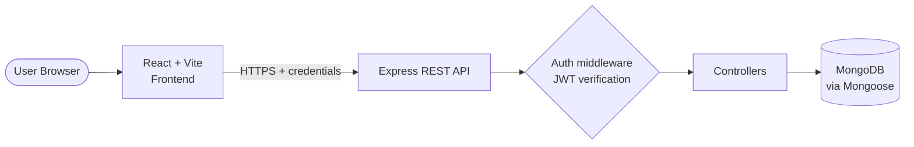
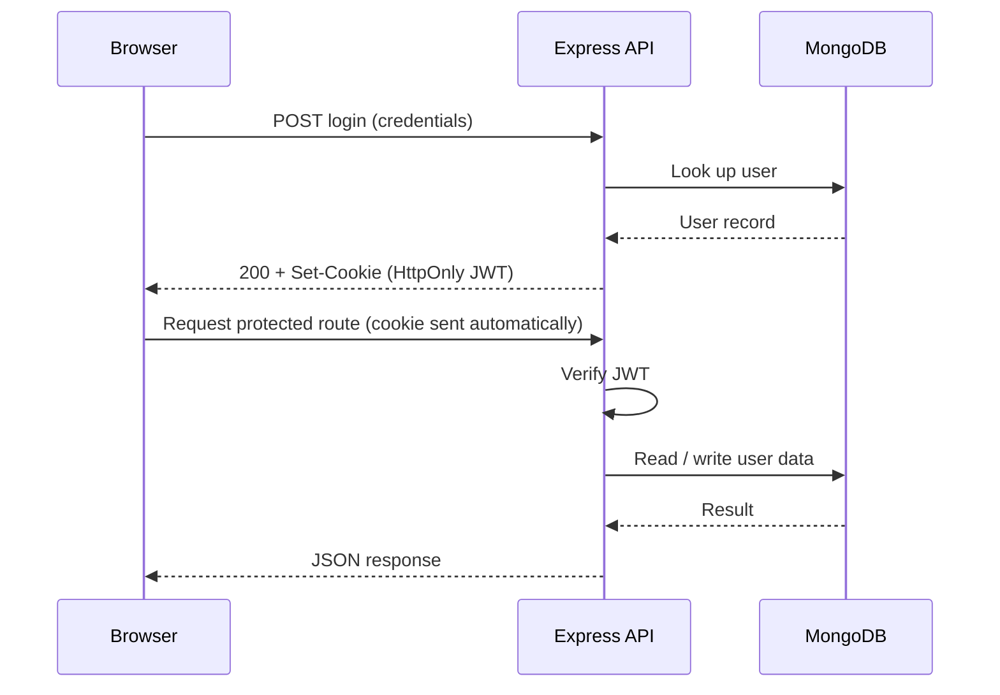

<div align="center">


<br />

**Plan smarter, prioritize clearly, and stay focused with one dashboard for every academic and personal task.**

<br />


<!-- Add after deployment:
[](YOUR_FRONTEND_URL)
-->

[Screenshots](#screenshots) · [Quick Start](#installation-and-local-setup) · [API](#api-overview) · [Deployment](#deployment-guide) · [Troubleshooting](#troubleshooting)

</div>

---

## Table of Contents

- [About the Project](#about-the-project)
- [Key Features](#key-features)
- [Screenshots](#screenshots)
- [Technology Stack](#technology-stack)
- [Application Architecture](#application-architecture)
- [Project Structure](#project-structure)
- [Prerequisites](#prerequisites)
- [Installation and Local Setup](#installation-and-local-setup)
- [Environment Variables](#environment-variables)
- [API Overview](#api-overview)
- [Authentication and Security](#authentication-and-security)
- [Deployment Guide](#deployment-guide)
- [Troubleshooting](#troubleshooting)
- [Future Enhancements](#future-enhancements)
- [Contributing](#contributing)
- [License](#license)
- [Author](#author)

---

## About the Project

TaskFlow is a full-stack web application that helps students organize academic and personal tasks in one place. A React single-page frontend talks to an Express REST API, and all data is stored in MongoDB, so each user's tasks persist across sessions and devices.

### At a Glance

| | |
| --- | --- |
| **Type** | Full-stack web application (SPA + REST API) |
| **Frontend** | React, Vite, Tailwind CSS |
| **Backend** | Node.js, Express.js |
| **Database** | MongoDB with Mongoose |
| **Auth** | JWT delivered in HttpOnly cookies |
| **Live demo** | `YOUR_FRONTEND_URL` |
| **API base URL** | `YOUR_BACKEND_URL/api` |

### The Problem

Students juggle assignments, exams, projects, club work, and personal commitments, often spread across notes apps, chat threads, and calendars. Deadlines slip and it becomes hard to decide what to work on next.

### The Approach

- **Centralize:** capture every task in one place.
- **Prioritize:** surface the work that matters most.
- **Track:** show progress through a productivity dashboard.
- **Focus:** support deep work with planner recommendations and focus sessions.

---

## Key Features

| Area | Capabilities |
| --- | --- |
| **Accounts** | User registration and login; protected routes that require authentication |
| **Tasks** | Create, edit, complete, and delete tasks; search and filtering |
| **Prioritization** | Task prioritization so the most important work is visible first |
| **Insights** | Productivity dashboard with statistics and analytics |
| **Planning** | Planner recommendations for what to work on next |
| **Focus** | Focus sessions to support concentrated study time |
| **Interface** | Responsive layout built with Tailwind CSS |

---

## Technology Stack

| Layer | Technologies |
| --- | --- |
| **Frontend** | React, Vite, Tailwind CSS |
| **Backend** | Node.js, Express.js |
| **Database** | MongoDB, Mongoose |
| **Authentication** | JSON Web Tokens (JWT), HttpOnly cookies |
| **Tooling** | Git, GitHub, VS Code |
| **Hosting** | Vercel (frontend), Render (backend), MongoDB Atlas (database) |

---

## Application Architecture



### Authentication Flow



### Data Flow

1. The user interacts with the React frontend.
2. The frontend calls the Express REST API with credentials included, so the browser attaches the authentication cookie.
3. On login or registration, the server signs a JWT and sets it in an HttpOnly cookie that frontend JavaScript cannot read.
4. For protected routes, middleware verifies the token before the controller runs.
5. Controllers read and write MongoDB through Mongoose models and return JSON.
6. The frontend renders the result: task lists, dashboard statistics, and planner suggestions.

---

## Project Structure

```text
taskflow/
├── docs/
│   ├── banner.svg
│   └── screenshots/            # login.png, dashboard.png, tasks.png, analytics.png
├── public/
├── src/                        # React frontend
│   ├── components/             # Reusable UI components
│   ├── pages/                  # Login, Register, Dashboard, ...
│   ├── context/                # Authentication context
│   ├── hooks/                  # Custom hooks
│   ├── services/               # API client layer
│   ├── App.jsx
│   └── main.jsx
├── server/                     # Express backend
│   ├── controllers/
│   ├── middleware/
│   ├── models/                 # Mongoose schemas
│   ├── routes/
│   ├── .env.example
│   ├── app.js
│   ├── server.js
│   └── package.json
├── .env.example                # Frontend environment template
├── .gitignore
├── index.html
├── package.json
├── vite.config.js
└── README.md
```

---

## Prerequisites

| Requirement | Notes |
| --- | --- |
| [Node.js](https://nodejs.org/) | Current LTS release recommended |
| npm | Bundled with Node.js |
| [Git](https://git-scm.com/) | To clone the repository |
| MongoDB | Local installation **or** a [MongoDB Atlas](https://www.mongodb.com/atlas) account |

```bash
node --version
npm --version
git --version
```

---

## Installation and Local Setup

> [!NOTE]
> The frontend and backend run as separate processes. Use two terminals.

**1. Clone the repository**

```bash
git clone YOUR_GITHUB_REPOSITORY_URL
cd YOUR_PROJECT_DIRECTORY
```

**2. Install dependencies**

```bash
npm install          # frontend (project root)
cd server
npm install          # backend
cd ..
```

**3. Create environment files** (see [Environment Variables](#environment-variables))

```powershell
# Windows PowerShell
Copy-Item .env.example .env
Copy-Item server\.env.example server\.env
```

```bash
# macOS / Linux
cp .env.example .env
cp server/.env.example server/.env
```

Edit both files and replace every placeholder.

**4. Start the backend (Terminal 1)**

```bash
cd server
npm run dev
```

**5. Start the frontend (Terminal 2)**

```bash
npm run dev
```

**6. Open the app**

Vite prints the local URL, typically `http://localhost:5173`. If that port is busy, Vite picks the next free one (for example `5174`). Use the URL shown in your terminal and make sure `CLIENT_ORIGIN` matches it.

---

## Environment Variables

> [!WARNING]
> Never commit real `.env` files. Commit only the `.env.example` templates.

### Frontend: `.env`

| Variable | Purpose | Required | Example |
| --- | --- | :---: | --- |
| `VITE_API_URL` | Base URL of the backend API | Yes | `http://localhost:5000/api` |

> [!IMPORTANT]
> Variables prefixed with `VITE_` are bundled into the browser build and are publicly visible. Never store secrets in them.

### Backend: `server/.env`

| Variable | Purpose | Required | Example |
| --- | --- | :---: | --- |
| `PORT` | Port the API listens on | No | `5000` |
| `NODE_ENV` | Runtime environment | Recommended | `development` |
| `MONGODB_URI` | MongoDB connection string | Yes | `mongodb://127.0.0.1:27017/taskflow` |
| `JWT_SECRET` | Secret used to sign tokens | Yes | `REPLACE_WITH_LONG_RANDOM_SECRET` |
| `JWT_EXPIRES_IN` | Token lifetime | Recommended | `7d` |
| `CLIENT_ORIGIN` | Allowed frontend origin (CORS) | Yes | `http://localhost:5173` |
| `COOKIE_SECURE` | Send the cookie over HTTPS only | Production: `true` | `false` |
| `COOKIE_SAME_SITE` | Cookie SameSite policy | Recommended | `lax` |

<details>
<summary><b>.env.example templates</b></summary>

<br />

Frontend (`.env.example`):

```env
VITE_API_URL=http://localhost:5000/api
```

Backend (`server/.env.example`):

```env
PORT=5000
NODE_ENV=development
MONGODB_URI=YOUR_MONGODB_CONNECTION_STRING
JWT_SECRET=REPLACE_WITH_A_LONG_RANDOM_SECRET
JWT_EXPIRES_IN=7d
CLIENT_ORIGIN=http://localhost:5173
COOKIE_SECURE=false
COOKIE_SAME_SITE=lax
```

Generate a strong secret:

```bash
node -e "console.log(require('crypto').randomBytes(48).toString('hex'))"
```

</details>

---

## API Overview

Endpoint paths are summarized here for orientation. The route files in `server/routes/` are the source of truth.

<!-- VERIFY every path and method below against server/routes before publishing. -->

| Category | Method and path | Auth |
| --- | --- | :---: |
| **Health** | `GET /api/health` | No |
| **Authentication** | `POST /api/auth/register` | No |
| | `POST /api/auth/login` | No |
| | `POST /api/auth/logout` | Yes |
| | `GET /api/auth/me` | Yes |
| **Tasks** | `GET /api/tasks` | Yes |
| | `POST /api/tasks` | Yes |
| | `PUT /api/tasks/:id` | Yes |
| | `DELETE /api/tasks/:id` | Yes |
| **Analytics** | `GET /api/analytics` | Yes |
| **Planner** | `GET /api/planner` | Yes |
| **Focus sessions** | `GET /api/focus-sessions` | Yes |
| | `POST /api/focus-sessions` | Yes |

---

## Authentication and Security

### How It Works

1. The user registers or logs in.
2. The server validates the request and signs a JWT with `JWT_SECRET`.
3. The token is returned in an **HttpOnly cookie**, which client-side JavaScript cannot read.
4. The browser sends the cookie with each request, and middleware verifies it on protected routes.
5. Logging out clears the cookie.

### Security Practices

| Area | Practice |
| --- | --- |
| **Passwords** | Store only salted hashes (for example bcrypt); never plain text |
| **Tokens** | Short, configurable lifetime via `JWT_EXPIRES_IN` |
| **Cookies** | HttpOnly; `Secure` and an explicit `SameSite` policy in production |
| **CORS** | Restrict to the configured `CLIENT_ORIGIN` with credentials enabled |
| **Secrets** | Kept in environment variables, never in source control |
| **Transport** | HTTPS required in production |
| **Input** | Validate and sanitize all incoming data on the server |

> [!NOTE]
> HttpOnly cookies reduce token exposure to scripts but are not a complete defense. Cookie-based authentication should also be assessed for CSRF risk.

### Production Checklist

- [ ] `JWT_SECRET` is long, random, and unique to production
- [ ] `COOKIE_SECURE=true` and the site is served over HTTPS
- [ ] `CLIENT_ORIGIN` equals the exact deployed frontend URL
- [ ] No `.env` file has ever been committed
- [ ] Atlas database user has least-privilege access and network access is restricted
- [ ] Dependencies are reviewed and updated regularly

---

## Deployment Guide

| Component | Platform |
| --- | --- |
| Database | MongoDB Atlas |
| Backend | Render |
| Frontend | Vercel |

| Service | URL |
| --- | --- |
| Frontend | `YOUR_FRONTEND_URL` |
| Backend | `YOUR_BACKEND_URL` |

### 1. MongoDB Atlas

1. Create a cluster and a database user with a strong password.
2. Allow network access from your backend host.
3. Copy the connection string for `MONGODB_URI`.

### 2. Backend on Render

1. Push the repository to GitHub.
2. Create a **Web Service** from the repository and set the root directory to `server`.
3. Build command: `npm install`. Start command: the production start script from `server/package.json` (commonly `npm start`).
4. Add environment variables:

```env
NODE_ENV=production
MONGODB_URI=YOUR_ATLAS_CONNECTION_STRING
JWT_SECRET=YOUR_PRODUCTION_SECRET
JWT_EXPIRES_IN=7d
CLIENT_ORIGIN=YOUR_FRONTEND_URL
COOKIE_SECURE=true
COOKIE_SAME_SITE=none
```

### 3. Frontend on Vercel

1. Import the repository and choose the **Vite** preset.
2. Build command `npm run build`, output directory `dist`.
3. Add the environment variable:

```env
VITE_API_URL=YOUR_BACKEND_URL/api
```

4. Deploy, then set the resulting URL as `CLIENT_ORIGIN` on Render and redeploy the backend.

### 4. Cross-Origin Cookie Requirements

When the frontend and backend live on different domains:

- Cookies need `Secure` (`COOKIE_SECURE=true`) and `SameSite=None` (`COOKIE_SAME_SITE=none`).
- CORS must allow the exact frontend origin with credentials enabled.
- The frontend must send requests with credentials included.
- Both sites must use HTTPS.

### 5. Post-Deployment Check

Register, log in, refresh the page to confirm the session persists, create and edit a task, then log out.

---

## Troubleshooting

<details>
<summary><b>Port 5000 is already in use</b></summary>

<br />

Change `PORT` in `server/.env`, update `VITE_API_URL` to match, and restart both servers. To find the process:

```powershell
netstat -ano | findstr :5000
```

```bash
lsof -i :5000
```

</details>

<details>
<summary><b>Vite starts on 5174 instead of 5173</b></summary>

<br />

Another process holds 5173. Stop it, or keep 5174 and set `CLIENT_ORIGIN=http://localhost:5174` in `server/.env`, then restart the backend.

</details>

<details>
<summary><b>CORS errors</b></summary>

<br />

`CLIENT_ORIGIN` must exactly match the browser origin, including protocol and port, with no trailing slash. Restart the backend after changing it.

</details>

<details>
<summary><b>MongoDB connection failures</b></summary>

<br />

- Verify `MONGODB_URI`, and URL-encode special characters in the password.
- For local MongoDB, confirm the service is running.
- For Atlas, confirm your IP or host is allowed under Network Access.

</details>

<details>
<summary><b>Login cookies not persisting</b></summary>

<br />

- Confirm the frontend sends requests with credentials.
- Locally, use `COOKIE_SECURE=false` over `http`.
- In production on separate domains, use `COOKIE_SECURE=true` and `COOKIE_SAME_SITE=none` over HTTPS.
- Confirm `CLIENT_ORIGIN` matches the frontend origin exactly.

</details>

<details>
<summary><b>Incorrect API URL</b></summary>

<br />

Confirm `VITE_API_URL` points to the API base path. Vite reads environment variables at startup and build time, so restart the dev server or rebuild after changing it.

</details>

<details>
<summary><b>Missing environment variables</b></summary>

<br />

Ensure both `.env` files exist and match their `.env.example` templates. A missing `MONGODB_URI` or `JWT_SECRET` commonly causes startup or authentication failures.

</details>

<details>
<summary><b>Dependency install or build failures</b></summary>

<br />

```bash
rm -rf node_modules package-lock.json
npm install
```

```powershell
Remove-Item -Recurse -Force node_modules, package-lock.json
npm install
```

</details>

---

## Future Enhancements

Ideas for future work. None of these are part of the current application.

- Recurring tasks
- Calendar integration
- Email or browser notifications
- Collaborative task management
- Advanced productivity insights

---

## Contributing

1. Fork the repository.
2. Create a branch: `git checkout -b feature/your-feature-name`
3. Make focused changes with clear commit messages.
4. Run the available scripts (for example, the build) to confirm nothing breaks.
5. Push your branch and open a pull request describing the change.

---

## License

<!-- No license confirmed. Choose one at https://choosealicense.com/, add a LICENSE file, and update this section. -->

License to be determined. Add a `LICENSE` file to the repository root and update this section.

---

<div align="center">
<sub>Built with React, Express, and MongoDB.</sub>
</div>